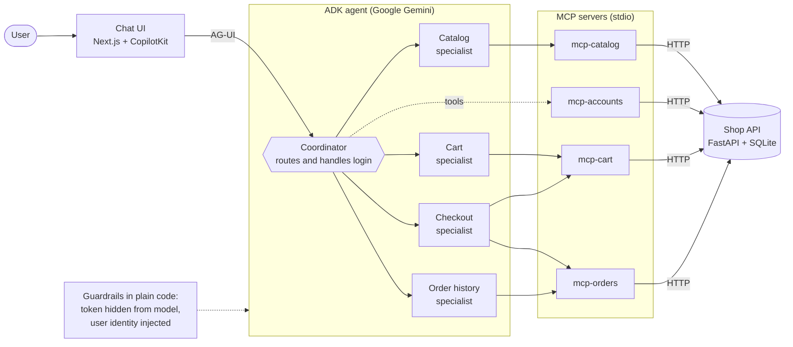

# The Smartest Thing Our AI Agent Does Is Say No

**Most AI demos show what a model can do. Ours is about the guardrails, and that's what makes it ready for real use.**

Ask a chatbot to "add the blue headphones to my cart" and it will happily say, "Done!" It lied. Nothing was added.

An AI agent actually does it. So we built one: a shopping assistant that searches products, manages your cart, checks you out and summarizes your orders, all through plain conversation.

Here's how it fits together, and what we learned.

## The architecture: boring on purpose

Five small pieces, each doing one job:

- **A fake shop backend.** Products priced in ₹, carts, orders and token auth, so we could experiment without touching real money.
- **Four MCP servers.** [MCP (Model Context Protocol)](https://modelcontextprotocol.io) is a standard way to hand tools to an AI. Ours are thin wrappers: catalog, accounts, cart and orders.
- **A team of agents.** Built with Google's Agent Development Kit (ADK): one **coordinator** that talks to you and routes requests, plus **specialists** for catalog, cart, checkout and order history.
- **A chat UI** in the browser.

The result: say "show me running shoes under ₹3,000," and the coordinator hands off to the catalog specialist. Say "buy it," and the checkout specialist takes over.

## See it in action

**[Insert GIF or video here: ~30 seconds, one continuous conversation]**

*Caption: a full shopping trip in plain English, from search to checkout.*

Here's what happens in the clip, and who handles each step:

| You say | What happens | Who handles it |
|---|---|---|
| "Show me running shoes under ₹3,000" | Searches the catalog and lists matches | Catalog specialist |
| "Add the second one to my cart" | Adds the item and confirms the cart | Cart specialist |
| "Check out" | Places the order using your saved address | Checkout specialist |
| "What did I order last week?" | Summarizes your order history | Order specialist |

Notice what you *don't* see: no menus, no forms, no copy-pasting IDs. The coordinator figures out who should answer, and the specialists do the work.

## Lesson 1: Small specialists beat one giant brain

One agent with 30 tools gets confused. A coordinator with focused specialists, each seeing only the tools it needs, stays sharp, and is easier to debug. When something goes wrong, you know which specialist to blame.

## Lesson 2: Never let the model hold the keys

This was our favourite design decision. LLMs can be tricked, so we made sure that even a tricked model couldn't do damage:

- **The password never reaches the model.** In the web app, login happens through a normal sign-in form, not in the chat.
- **The auth token is hidden from the AI.** After login, the server stores it in session state and strips it from anything the model or browser sees.
- **The model can't pick whose account to act on.** Before any user-specific tool runs, our code overwrites the token argument with the logged-in user's. The model can ask for "my cart," but never "someone else's cart."

**[Optional: insert a short clip or screenshot here. While signed in as one user, ask for another user's cart and show that the agent can only ever see your own.]**

The principle: **let the AI decide _what_ to do, and let plain code decide _who_ it's allowed to do it as.**

## Lesson 3: Test the plumbing, not the personality

You can't unit-test an LLM's mood. But you can test everything around it. Our callbacks and wiring are covered by tests that need **no model and no API calls**, so they run in seconds and never flake.

## Lesson 4: A fake backend is a superpower

Building against a disposable shop meant we could break things freely. Reset the data by deleting one file. That freedom made us braver, and faster.

## What's next

**[Add your real next steps: e.g. payments, recommendations, evals, deployment.]**

## The takeaway

Building an agent wasn't about finding the smartest model. It was about **good boundaries**: small specialists, standard tools, and a hard line around anything sensitive.

If you build something similar, I'd love to hear what you hand your agent first. 👇

_Tags: AI Agents, Google ADK, MCP, Generative AI, Python_

---

### Before you publish

- **Diagram:** Medium doesn't render Mermaid. Paste the diagram block into [mermaid.live](https://mermaid.live), export a PNG, and upload it in place of the code block.
- **Credentials:** the repo README lists demo emails and passwords. Remove them before making the repo public.
- **`.env` file:** confirm `adk-chat-agents/.env` is gitignored and holds no real project IDs or keys.
- **Fill the placeholders:** the **[ ]** items (next steps, repo link), plus a screenshot or GIF of the chat doing a real task.
- **Model:** the project defaults to `gemini-2.5-flash`. Mention it if readers will want to reproduce your setup.
